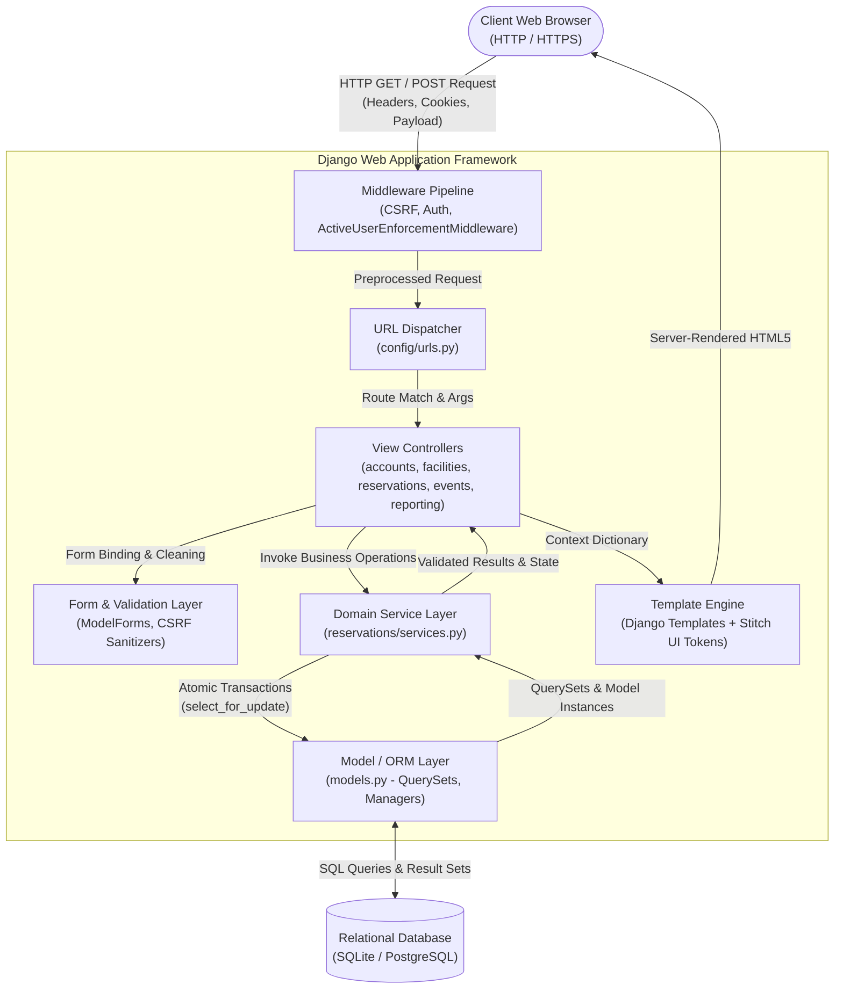
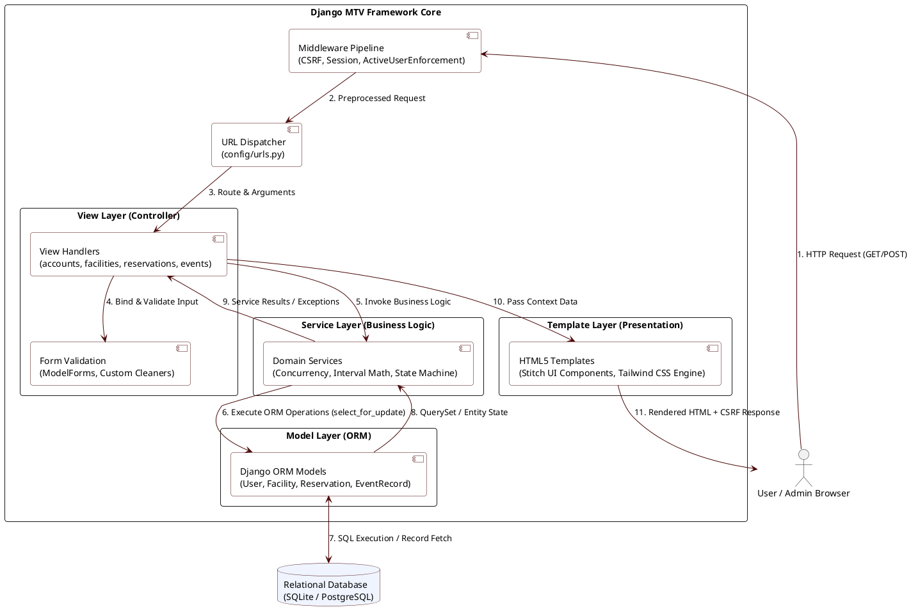
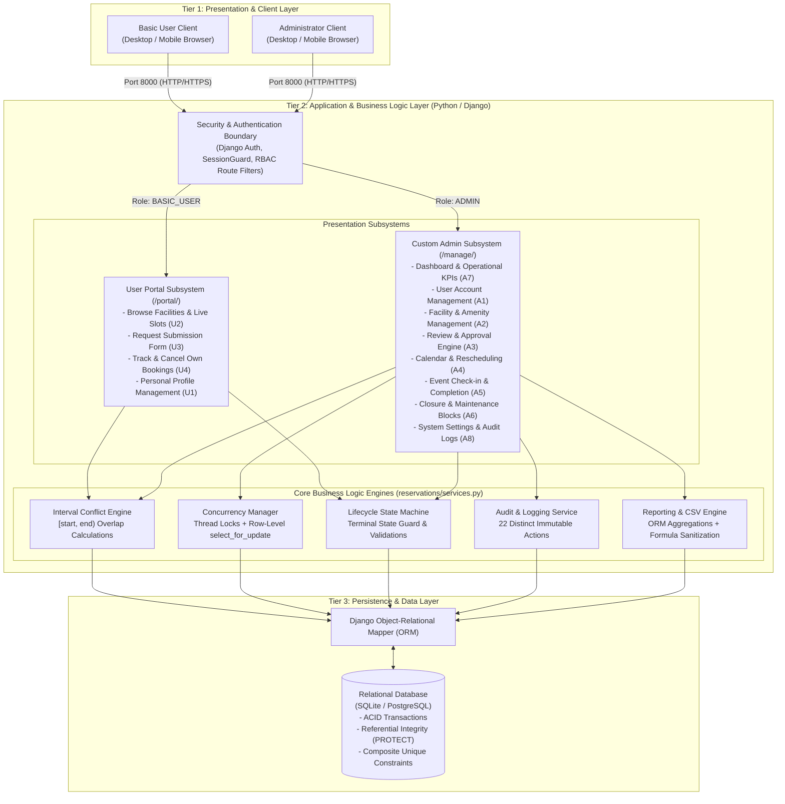
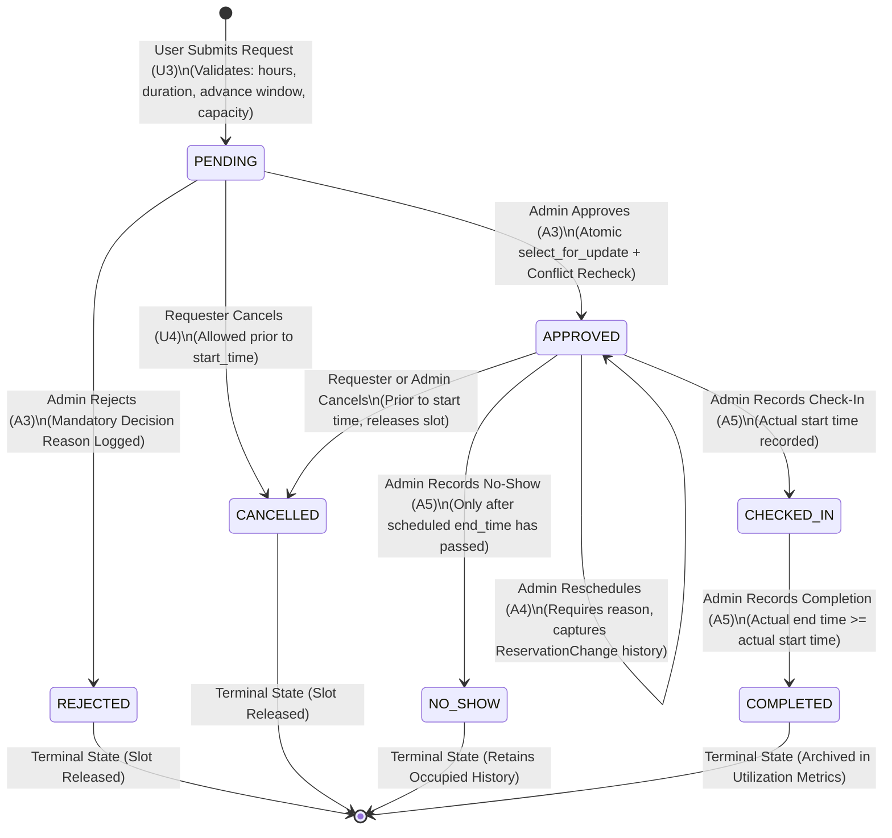
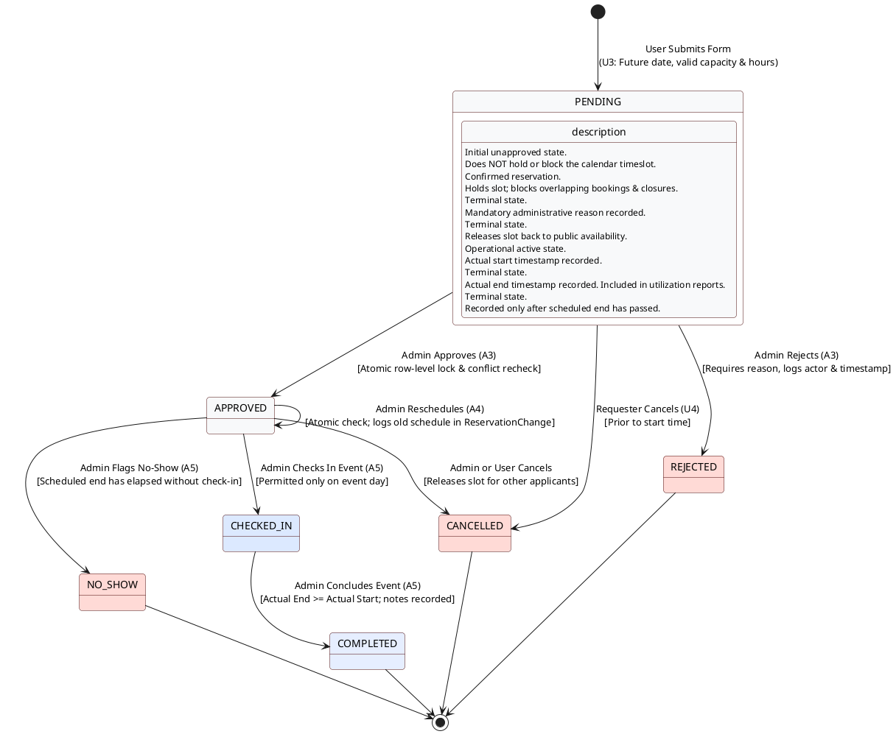
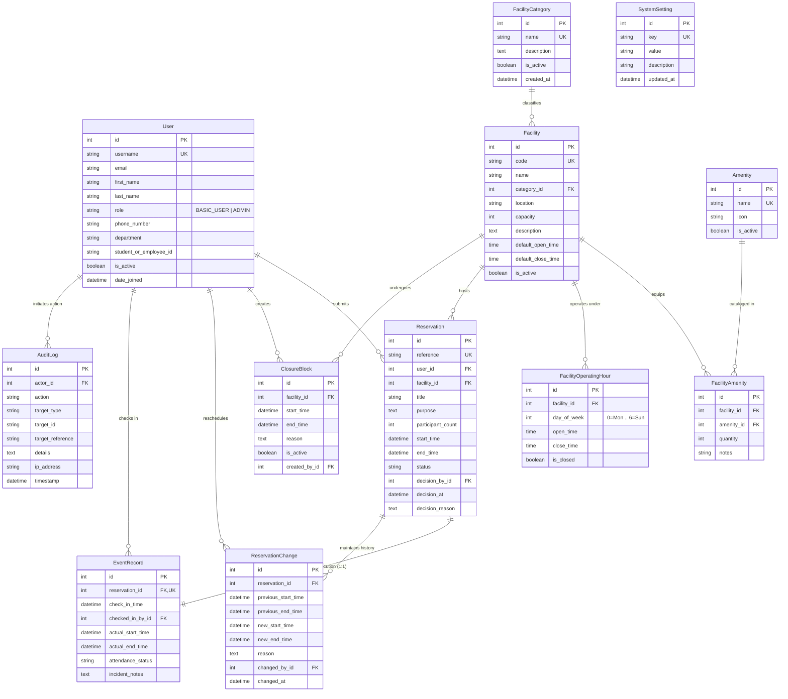
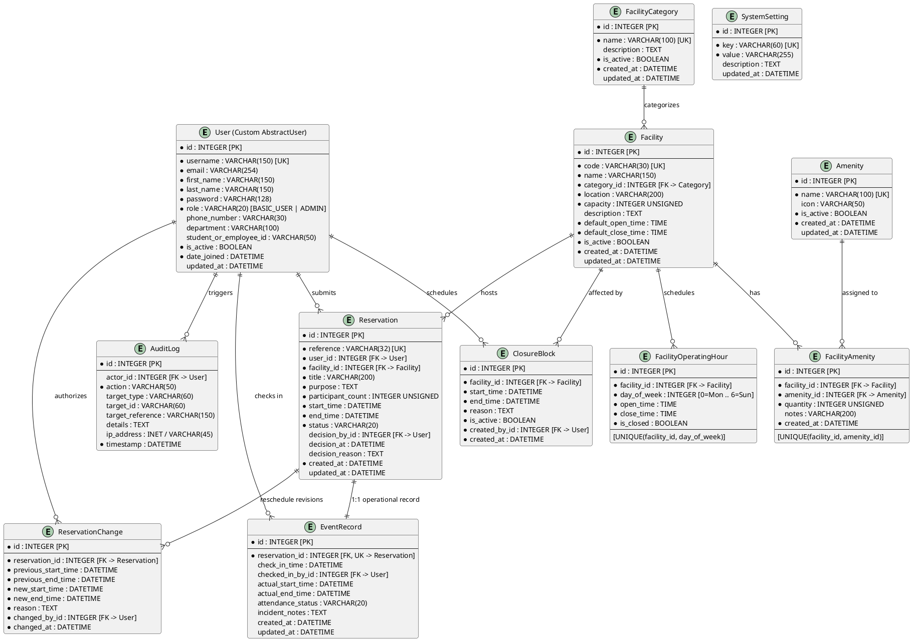

# Campus Facility Reservation and Event Scheduling System (BulSU CARES)
## Technical Design Specification: System & Database Architecture
**Course:** IT 401W - Web Programming and Frameworks (Final Project B)  
**Evaluator:** Dr. Aaron Paul M. Dela Rosa  
**Technology Stack:** Python 3.14, Django 6.0, SQLite (Dev) / PostgreSQL (Prod), Tailwind CSS, Material Symbols  

---

## 3. System Design

### 3.1 MTV (Model-Template-View) Architecture Diagram

Django implements the **Model-Template-View (MTV)** architectural pattern, a specialized adaptation of MVC designed specifically for server-rendered web applications. In this architecture:
- **Model Layer (`models.py`):** Represents the data structure, encapsulates business logic constraints, and interfaces with the underlying database via the Django Object-Relational Mapper (ORM).
- **Template Layer (`templates/`):** Manages presentation markup and user interface components, rendered using Django Template Language (DTL) integrated with Tailwind CSS tokens and Google Stitch design components.
- **View Layer (`views.py`):** Acts as the controller/orchestrator. It intercepts incoming HTTP requests, validates permissions (`@admin_required`, `@active_user_required`), invokes service layer methods, queries models, and binds dynamic context to the presentation templates.
- **Service Layer (`services.py`):** An auxiliary architectural pattern decoupling core business rules (half-open interval arithmetic, atomic row-level locks, and workflow transitions) from views.

#### MTV Architectural Workflow Diagram (Mermaid)



---

#### MTV Diagram Code for Draw.io (PlantUML)
*To use in draw.io: Click `Arrange` &rarr; `Insert` &rarr; `Advanced` &rarr; `PlantUML`, paste the block below, and click `Insert`.*



#### MTV Diagram Code for Lucidchart (UML Sequence Markup)
*To use in Lucidchart: Open shape panel &rarr; select **UML Sequence** &rarr; click **Use Markup** &rarr; paste the block below &rarr; click **Build**.*

```text
Browser -> Middleware: 1. HTTP Request (GET/POST)
Middleware -> URLDispatcher: 2. Match URL Pattern
URLDispatcher -> ViewLayer: 3. Invoke View Handler
ViewLayer -> FormValidation: 4. Bind & Validate Input
ViewLayer -> ServiceLayer: 5. Execute Business Rules
ServiceLayer -> ModelORM: 6. select_for_update() Lock
ModelORM -> RelationalDatabase: 7. Execute SQL
RelationalDatabase --> ModelORM: 8. Return Record Set
ModelORM --> ServiceLayer: 9. Return Model Entities
ServiceLayer --> ViewLayer: 10. Return Validated Outcome
ViewLayer -> TemplateEngine: 11. Pass Context Dictionary
TemplateEngine --> Browser: 12. Rendered HTML + CSRF Response
```

---

### 3.2 System Architecture

The Campus Facility Reservation and Event Scheduling System is architected as a **modular three-tier enterprise web application**. The system adheres strictly to the project mandate: approximately 75% of development effort is focused on the custom administrative side and 25% on the basic-user portal, with zero reliance on Django's built-in `django.contrib.admin`.



---

#### System Architecture Diagram Code for Draw.io (PlantUML)

```plantuml
@startuml
skinparam backgroundColor #FFFFFF
skinparam defaultFontName Arial
skinparam packageStyle rectangle
skinparam roundcorner 8
skinparam shadowing false

package "Tier 1: Presentation Tier (Client Devices)" {
    actor "Basic User\n(Student / Faculty)" as BasicUser
    actor "Administrator\n(PFLMO Staff)" as AdminUser
}

package "Tier 2: Application Tier (Django 6.0 / Python 3.14)" {
    node "Security & Authentication Gateway" as Gateway {
        component "RBAC Route Controller\n(Redirect to /portal/ or /manage/)" as RBAC
        component "ActiveUserEnforcementMiddleware\n(Live Session Invalidation)" as SessionGuard
    }
    
    package "Portal Subsystem (/portal/)" {
        component "Facility Directory & Slot Preview (U2)" as U2
        component "Reservation Request Submission (U3)" as U3
        component "Booking Tracker & Self-Cancellation (U4)" as U4
        component "User Profile & Account Info (U1)" as U1
    }
    
    package "Custom Admin Subsystem (/manage/)" {
        component "Operational Dashboard & KPIs (A7)" as A7
        component "User Account Management (A1)" as A1
        component "Facility & Amenities Management (A2)" as A2
        component "Review, Approval & Conflict Resolution (A3)" as A3
        component "Calendar & Approved Rescheduling (A4)" as A4
        component "Event Operations & Gate Slips (A5)" as A5
        component "Closure & Maintenance Blocks (A6)" as A6
        component "System Settings & Audit Trail (A8)" as A8
    }
    
    package "Domain Logic Services" {
        component "Interval Conflict Engine\n[start, end) Mathematics" as ConflictEngine
        component "Concurrency Serialization\nselect_for_update() + In-Process Lock" as ConcurrencyEngine
        component "State Machine Engine\nTerminal State Integrity" as StateEngine
        component "Audit Trail Logging" as AuditLogger
        component "Reporting & CSV Sanitizer" as ReportEngine
    }
}

package "Tier 3: Persistence Tier" {
    component "Django ORM" as ORM
    database "Relational Database\n(SQLite / PostgreSQL)" as DB
}

BasicUser --> Gateway : HTTPS Requests
AdminUser --> Gateway : HTTPS Requests

Gateway --> RBAC
RBAC --> PortalModule : BASIC_USER
RBAC --> AdminModule : ADMIN

PortalModule ..> ConflictEngine
PortalModule ..> StateEngine

AdminModule ..> ConcurrencyEngine
AdminModule ..> ConflictEngine
AdminModule ..> StateEngine
AdminModule ..> AuditLogger
AdminModule ..> ReportEngine

ConflictEngine --> ORM
ConcurrencyEngine --> ORM
StateEngine --> ORM
AuditLogger --> ORM
ReportEngine --> ORM

ORM <--> DB

@enduml
```



#### System Architecture Code for Lucidchart (UML Sequence Markup)
*To use in Lucidchart: In **UML Sequence** shape panel, click **Use Markup**, paste the text below, and click **Build**.*

```text
ClientDevice -> SecurityGateway: 1. Send HTTPS Request
SecurityGateway -> RBACController: 2. Check Session & Role
alt Role: BASIC_USER
    RBACController -> PortalSubsystem: 3a. Route to /portal/
    PortalSubsystem -> ConflictEngine: 4a. Check Facility Slots
    ConflictEngine -> Database: 5a. Query Active Bookings
else Role: ADMIN
    RBACController -> AdminSubsystem: 3b. Route to /manage/
    AdminSubsystem -> ConcurrencyLock: 4b. Acquire In-Process Lock
    ConcurrencyLock -> Database: 5b. Atomic select_for_update()
end
Database --> ClientDevice: 6. Return Server-Rendered HTML
```

---

### 3.3 User Roles and Access Control

#### 3.3.1 Role Definition & Prohibitions
The project strictly enforces **exactly two application roles** defined in [`accounts/models.py`](file:///c:/Users/Admin/Desktop/Group1.py/accounts/models.py):
1. **`BASIC_USER`:** Represents campus students, faculty members, and student organization leaders. Authorized only to browse facilities, check public slot availability, submit pending requests, track own bookings, cancel own unstarted bookings, and edit personal contact details.
2. **`ADMIN`:** Represents Physical Facilities and Logistics Management Office (PFLMO) officers. Authorized to perform all managerial, operational, scheduling, approval, facility closure, reporting, and audit actions.

> [!IMPORTANT]
> **Zero Third-Role Policy:** The system prohibits auxiliary roles such as "staff", "approver", "technician", or "supervisor". All administrative workflows are unified under the `ADMIN` role.

#### 3.3.2 Role-Based Access Control (RBAC) Matrix

| Functional Module | Operation / Action | Basic User | Admin | Enforcement Mechanism |
| :--- | :--- | :---: | :---: | :--- |
| **Authentication** | Register Account | Allowed | Denied | `UserRegistrationForm` hardcodes `role = ROLE_BASIC`. |
| | Sign In & Authentication | Allowed | Allowed | `django.contrib.auth.authenticate()` |
| | Root Redirection (`/`) | &rarr; `/portal/` | &rarr; `/manage/` | `root_redirect()` in `config/urls.py` |
| **User Profile (U1)** | View & Edit Personal Info | Own Only | All | `user == request.user`; `UserProfileForm` excludes `role`/`status`. |
| | Change Role / Active Status | Denied | Allowed | Admins only via `admin_user_toggle_status`. |
| **Facilities (A2, U2)**| Browse Active Venues | Allowed | Allowed | Public catalogue view. |
| | View Slot Availability | Masked | Full Details | Basic users receive masked status; admins see booking context. |
| | Create, Edit, Archive Venue | Denied | Allowed | Protected by `@admin_required`. |
| | Manage Operating Hours | Denied | Allowed | Protected by `@admin_required`. |
| | Manage Amenity Catalog | Denied | Allowed | Protected by `@admin_required`. |
| **Reservations (A3, U3)**| Submit Request | Allowed | Denied | `user_reservation_create` (starts in `PENDING` state). |
| | Review Queue & Details | Denied | Allowed | `@admin_required`; shows capacity/closure checks. |
| | Approve Request | Denied | Allowed | `approve_reservation()` with atomic row locking. |
| | Reject Request | Denied | Allowed | `reject_reservation()` requiring non-empty reason. |
| | Reschedule Approved Booking| Denied | Allowed | `reschedule_approved_reservation()` (A4). |
| **Tracking (U4)** | View Booking List | Own Only | All | `Reservation.objects.filter(user=request.user)`. |
| | Cancel Booking | Own Only | Allowed | Allowed before start time; releases facility slot. |
| **Operations (A5)** | Record Check-In | Denied | Allowed | Permitted only on `APPROVED` status. |
| | Record Completion | Denied | Allowed | Permitted only on `CHECKED_IN` status. |
| | Record No-Show | Denied | Allowed | Permitted only after scheduled end time has passed. |
| | Print Reservation Slip | Denied | Allowed | `admin_event_print_slip` (A5). |
| **Closures (A6)** | Create Maintenance Closure | Denied | Allowed | Overlap scanner prevents silent overrides. |
| | Archive Closure Block | Denied | Allowed | `admin_closure_archive` with audit entry. |
| **Reports (A7)** | View Dashboard KPI Cards | Denied | Allowed | `@admin_required`. |
| | Run Analytics & Export CSV | Denied | Allowed | Protected by `@admin_required` + CSV formula sanitizer. |
| **Audit & Settings (A8)**| View Immutable Audit Log | Denied | Allowed | Searchable, paginated audit trail. |
| | Configure Booking Policies | Denied | Allowed | Max event duration & advance booking window settings. |

#### 3.3.3 Security & Deactivation Safeguards
- **Active User Session Enforcement Middleware:** Defined in [`accounts/middleware.py`](file:///c:/Users/Admin/Desktop/Group1.py/accounts/middleware.py). On every incoming HTTP request, the middleware queries the database for `request.user.is_active`. If an administrator deactivates a user account, the user's active session is instantly flushed and destroyed, terminating in-flight transactions.
- **Inherent IDOR Protection:** All user portal endpoints strictly scope database queries using `filter(user=request.user)`. Modifying query parameters or URLs cannot expose or mutate another user's reservation record.

---

### 3.4 Reservation Workflow Diagram

The reservation lifecycle represents a finite state machine composed of seven distinct states, strictly guarding against illegal transitions and unauthorized state reopening.



---

#### Workflow Diagram Code for Draw.io (PlantUML)



#### Reservation Workflow Code for Lucidchart (UML Sequence Markup)
*To use in Lucidchart: In **UML Sequence** shape panel, click **Use Markup**, paste the text below, and click **Build**.*

```text
User -> ReservationSystem: 1. Submit Booking Form (PENDING)
Admin -> ReservationSystem: 2. Review Request Details
alt Approved
    Admin -> ReservationSystem: 3a. Approve Booking (APPROVED)
    ReservationSystem -> Calendar: 4a. Lock Timeslot [start, end)
else Rejected
    Admin -> ReservationSystem: 3b. Reject Booking (REJECTED)
    ReservationSystem -> Requester: 4b. Notify with Reason
else Cancelled
    Requester -> ReservationSystem: 3c. Cancel Request (CANCELLED)
    ReservationSystem -> Calendar: 4c. Release Timeslot
end

opt Day of Event Operations
    Admin -> EventOperations: 5a. Record Check-In (CHECKED_IN)
    Admin -> EventOperations: 6a. Conclude Event (COMPLETED)
end

opt Absence Detected
    Admin -> EventOperations: 5b. Flag No-Show (NO_SHOW)
end
```

---

### 3.5 Business Rules Specification

The application enforces twelve fundamental business rules validated on the server side:

1. **Half-Open Interval Overlap Rule:**  
   Time windows are treated as half-open intervals: $[start, end)$. Two intervals $A = [S_A, E_A)$ and $B = [S_B, E_B)$ overlap if and only if:
   $$S_A < E_B \quad \land \quad E_A > S_B$$
   Adjacent reservations (e.g., $E_A = 10:00$ and $S_B = 10:00$) meet at the exact endpoint and are **strictly valid and non-conflicting**.

2. **Slot Reservation by State:**  
   - Submissions in `PENDING` status **do not** block or reserve a timeslot.
   - Reservations in `APPROVED` and `CHECKED_IN` status, alongside active `ClosureBlock` records, **actively block** all overlapping bookings.
   - Reservations in `CANCELLED` and `REJECTED` status **immediately release** timeslot holds.
   - Reservations in `COMPLETED` and `NO_SHOW` status retain historical occupancy for utilization tracking.

3. **Single Operating Day Rule:**  
   Every booking must start and end on the **same calendar date** ($S_A.\text{date} == E_A.\text{date}$) and fall completely within the facility's day-specific operating hours. Overnight events are strictly prohibited.

4. **Chronological Validity:**  
   - The requested start time must be in the future relative to the transaction time ($S_A > \text{now}$).
   - The end time must be strictly after the start time ($E_A > S_A$).

5. **Advance Booking Window Limit:**  
   The scheduled start datetime cannot exceed the configurable advance window:
   $$S_A \le \text{now} + \text{MAX\_ADVANCE\_DAYS (default: 30 days)}$$

6. **Maximum Event Duration Limit:**  
   The requested continuous booking duration cannot exceed the policy limit:
   $$E_A - S_A \le \text{MAX\_DURATION\_HOURS (default: 4 hours)}$$

7. **Capacity Compliance:**  
   Expected participant count must satisfy:
   $$1 \le \text{participant\_count} \le \text{facility.capacity}$$

8. **Concurrency & Race Condition Serialization:**  
   During approval and rescheduling, the system executes within `transaction.atomic()` using `select_for_update()` on both the `Reservation` and parent `Facility` rows, reinforced by an in-process threading lock (`_approval_concurrency_lock`). When two administrators simultaneously attempt to approve overlapping requests, exactly one succeeds while the second fails cleanly with a `ReservationConflictError`, leaving the unapproved request safely in `PENDING` state.

9. **Closure Conflict Precedence:**  
   A maintenance or institutional closure cannot be created over an existing `APPROVED` or `CHECKED_IN` booking. The system displays all conflicting bookings, requiring the administrator to explicitly reschedule or cancel them with a reason before the closure can be committed.

10. **Event Operations Timing Rules:**  
    - Check-in can only be executed on reservations with `APPROVED` status.
    - An event cannot be marked `COMPLETED` unless it has been `CHECKED_IN`.
    - Actual end datetime cannot precede actual start datetime ($\text{actual\_end} \ge \text{actual\_start}$).
    - `NO_SHOW` can only be recorded after the scheduled end datetime has passed without a check-in record.

11. **Privacy Protection Rule (U2):**  
    When basic users inspect facility availability, the system calculates hourly intervals and returns only generic `"Available"` or `"Booked"`/`"Facility Closed"` indicators. Personal applicant identities, student IDs, event titles, and administrative notes are **strictly withheld**.

12. **CSV Formula Injection Safeguard:**  
    All dynamic spreadsheet export values are passed through `sanitize_csv_cell()`. Any field beginning with formula trigger characters (`=`, `+`, `-`, `@`) is prepended with a single quotation mark (`'`), neutralizing executable command injection in spreadsheet software.

---

## 4. Database Design

### 4.1 Database Entity-Relationship Diagram (ERD)

The database schema is normalized to Third Normal Form (3NF) and consists of twelve relational entities.



---

#### ERD Code for Draw.io (PlantUML)



---

#### Database ERD SQL for Lucidchart (Native Database Import)
*To use in Lucidchart: In left shape panel &rarr; click **+ More Shapes** &rarr; check **Entity Relationship** &rarr; click **Import** &rarr; select **PostgreSQL** or **Standard SQL** &rarr; paste the DDL script below &rarr; click **Import**. Lucidchart will automatically generate all 12 tables, fields, types, PK/FK tags, and relationship lines.*

```sql
CREATE TABLE accounts_user (
    id SERIAL PRIMARY KEY,
    username VARCHAR(150) NOT NULL UNIQUE,
    password VARCHAR(128) NOT NULL,
    email VARCHAR(254) NOT NULL,
    first_name VARCHAR(150),
    last_name VARCHAR(150),
    role VARCHAR(20) NOT NULL,
    phone_number VARCHAR(30),
    department VARCHAR(100),
    student_or_employee_id VARCHAR(50),
    is_active BOOLEAN NOT NULL DEFAULT TRUE,
    date_joined TIMESTAMP NOT NULL,
    updated_at TIMESTAMP
);

CREATE TABLE facilities_facilitycategory (
    id SERIAL PRIMARY KEY,
    name VARCHAR(100) NOT NULL UNIQUE,
    description TEXT,
    is_active BOOLEAN NOT NULL DEFAULT TRUE,
    created_at TIMESTAMP NOT NULL,
    updated_at TIMESTAMP
);

CREATE TABLE facilities_facility (
    id SERIAL PRIMARY KEY,
    code VARCHAR(30) NOT NULL UNIQUE,
    name VARCHAR(150) NOT NULL,
    category_id INTEGER NOT NULL REFERENCES facilities_facilitycategory(id),
    location VARCHAR(200) NOT NULL,
    capacity INTEGER NOT NULL,
    description TEXT,
    default_open_time TIME NOT NULL,
    default_close_time TIME NOT NULL,
    is_active BOOLEAN NOT NULL DEFAULT TRUE,
    created_at TIMESTAMP NOT NULL,
    updated_at TIMESTAMP
);

CREATE TABLE facilities_amenity (
    id SERIAL PRIMARY KEY,
    name VARCHAR(100) NOT NULL UNIQUE,
    icon VARCHAR(50),
    is_active BOOLEAN NOT NULL DEFAULT TRUE,
    created_at TIMESTAMP NOT NULL,
    updated_at TIMESTAMP
);

CREATE TABLE facilities_facilityamenity (
    id SERIAL PRIMARY KEY,
    facility_id INTEGER NOT NULL REFERENCES facilities_facility(id),
    amenity_id INTEGER NOT NULL REFERENCES facilities_amenity(id),
    quantity INTEGER NOT NULL DEFAULT 1,
    notes VARCHAR(200),
    created_at TIMESTAMP NOT NULL,
    CONSTRAINT uq_facility_amenity UNIQUE (facility_id, amenity_id)
);

CREATE TABLE facilities_facilityoperatinghour (
    id SERIAL PRIMARY KEY,
    facility_id INTEGER NOT NULL REFERENCES facilities_facility(id),
    day_of_week INTEGER NOT NULL,
    open_time TIME NOT NULL,
    close_time TIME NOT NULL,
    is_closed BOOLEAN NOT NULL DEFAULT FALSE,
    CONSTRAINT uq_facility_day UNIQUE (facility_id, day_of_week)
);

CREATE TABLE reservations_reservation (
    id SERIAL PRIMARY KEY,
    reference VARCHAR(32) NOT NULL UNIQUE,
    user_id INTEGER NOT NULL REFERENCES accounts_user(id),
    facility_id INTEGER NOT NULL REFERENCES facilities_facility(id),
    title VARCHAR(200) NOT NULL,
    purpose TEXT NOT NULL,
    participant_count INTEGER NOT NULL,
    start_time TIMESTAMP NOT NULL,
    end_time TIMESTAMP NOT NULL,
    status VARCHAR(20) NOT NULL,
    decision_by_id INTEGER REFERENCES accounts_user(id),
    decision_at TIMESTAMP,
    decision_reason TEXT,
    created_at TIMESTAMP NOT NULL,
    updated_at TIMESTAMP
);

CREATE TABLE reservations_closureblock (
    id SERIAL PRIMARY KEY,
    facility_id INTEGER NOT NULL REFERENCES facilities_facility(id),
    start_time TIMESTAMP NOT NULL,
    end_time TIMESTAMP NOT NULL,
    reason TEXT NOT NULL,
    is_active BOOLEAN NOT NULL DEFAULT TRUE,
    created_by_id INTEGER NOT NULL REFERENCES accounts_user(id),
    created_at TIMESTAMP NOT NULL
);

CREATE TABLE reservations_reservationchange (
    id SERIAL PRIMARY KEY,
    reservation_id INTEGER NOT NULL REFERENCES reservations_reservation(id),
    previous_start_time TIMESTAMP NOT NULL,
    previous_end_time TIMESTAMP NOT NULL,
    new_start_time TIMESTAMP NOT NULL,
    new_end_time TIMESTAMP NOT NULL,
    reason TEXT NOT NULL,
    changed_by_id INTEGER NOT NULL REFERENCES accounts_user(id),
    changed_at TIMESTAMP NOT NULL
);

CREATE TABLE events_eventrecord (
    id SERIAL PRIMARY KEY,
    reservation_id INTEGER NOT NULL UNIQUE REFERENCES reservations_reservation(id),
    check_in_time TIMESTAMP,
    checked_in_by_id INTEGER REFERENCES accounts_user(id),
    actual_start_time TIMESTAMP,
    actual_end_time TIMESTAMP,
    attendance_status VARCHAR(20) NOT NULL,
    incident_notes TEXT,
    created_at TIMESTAMP NOT NULL,
    updated_at TIMESTAMP
);

CREATE TABLE audit_settings_auditlog (
    id SERIAL PRIMARY KEY,
    actor_id INTEGER REFERENCES accounts_user(id),
    action VARCHAR(50) NOT NULL,
    target_type VARCHAR(60),
    target_id VARCHAR(60),
    target_reference VARCHAR(150),
    details TEXT,
    ip_address VARCHAR(45),
    timestamp TIMESTAMP NOT NULL
);

CREATE TABLE audit_settings_systemsetting (
    id SERIAL PRIMARY KEY,
    key VARCHAR(60) NOT NULL UNIQUE,
    value VARCHAR(255) NOT NULL,
    description TEXT,
    updated_at TIMESTAMP NOT NULL
);
```

---

### 4.2 Data Dictionary

#### 1. Entity: `User` (`accounts_user`)
Inherits from Django's `AbstractUser`. Stores identity, credentials, role level, and university affiliation.

| Field Name | Data Type | Constraints | Nullable | Default | Description |
| :--- | :--- | :--- | :---: | :--- | :--- |
| `id` | BigAutoField | PK | No | Auto | Surrogate primary key. |
| `username` | CharField(150) | Unique, Index | No | — | University username (e.g. `juan.delacruz`). |
| `password` | CharField(128) | — | No | — | Cryptographically hashed password (PBKDF2/SHA256). |
| `email` | EmailField(254)| — | No | — | University email address (`@bulsu.edu.ph`). |
| `first_name` | CharField(150) | — | Yes | `""` | User's legal first name. |
| `last_name` | CharField(150) | — | Yes | `""` | User's legal last name. |
| `role` | CharField(20) | Choices | No | `'BASIC_USER'`| Application role: `BASIC_USER` or `ADMIN`. |
| `phone_number` | CharField(30) | — | Yes | `""` | Contact phone number for notification slips. |
| `department` | CharField(100) | — | Yes | `""` | College, department, or student organization. |
| `student_or_employee_id` | CharField(50) | — | Yes | `""` | Official BulSU identification card number. |
| `is_active` | BooleanField | — | No | `True` | Account status flag. Deactivation invalidates sessions. |
| `date_joined` | DateTimeField | — | No | `timezone.now`| Account creation timestamp. |

---

#### 2. Entity: `FacilityCategory` (`facilities_facilitycategory`)
Classifies facilities into functional groupings (e.g., Auditoriums, Computer Laboratories, Boardrooms).

| Field Name | Data Type | Constraints | Nullable | Default | Description |
| :--- | :--- | :--- | :---: | :--- | :--- |
| `id` | BigAutoField | PK | No | Auto | Surrogate primary key. |
| `name` | CharField(100) | Unique | No | — | Classification label (e.g., `Auditoriums & Halls`). |
| `description` | TextField | — | Yes | `""` | Scope and equipment guidelines for category. |
| `is_active` | BooleanField | — | No | `True` | Active status flag for soft archiving. |
| `created_at` | DateTimeField | — | No | `auto_now_add`| Timestamp when category was registered. |

---

#### 3. Entity: `Facility` (`facilities_facility`)
Physical spaces, halls, and rooms available for reservation.

| Field Name | Data Type | Constraints | Nullable | Default | Description |
| :--- | :--- | :--- | :---: | :--- | :--- |
| `id` | BigAutoField | PK | No | Auto | Surrogate primary key. |
| `code` | CharField(30) | Unique, Index | No | — | Institutional facility code (e.g., `AUD-101`, `HALL-A`). |
| `name` | CharField(150) | — | No | — | Full facility name (e.g., `Valencia Hall`). |
| `category_id` | ForeignKey | FK &rarr; Category, PROTECT | No | — | Classification foreign key reference. |
| `location` | CharField(200) | — | No | — | Campus building and floor designation. |
| `capacity` | PositiveInteger | $\ge 1$ | No | — | Maximum safe attendee headcount. |
| `description` | TextField | — | Yes | `""` | Physical specifications and venue rules. |
| `default_open_time` | TimeField | — | No | `08:00:00` | Standard default opening hour. |
| `default_close_time`| TimeField | — | No | `21:00:00` | Standard default closing hour. |
| `is_active` | BooleanField | — | No | `True` | Active status flag; preserves historical links. |

---

#### 4. Entity: `Amenity` (`facilities_amenity`)
Master catalog of reusable equipment and physical features.

| Field Name | Data Type | Constraints | Nullable | Default | Description |
| :--- | :--- | :--- | :---: | :--- | :--- |
| `id` | BigAutoField | PK | No | Auto | Surrogate primary key. |
| `name` | CharField(100) | Unique | No | — | Equipment name (e.g., `Sound System`, `Projector`). |
| `icon` | CharField(50) | — | Yes | `'bi-box'` | Bootstrap / Material icon class identifier. |
| `is_active` | BooleanField | — | No | `True` | Soft-archiving flag. |

---

#### 5. Entity: `FacilityAmenity` (`facilities_facilityamenity`)
Intermediary junction table associating amenities with facilities and tracking quantities.

| Field Name | Data Type | Constraints | Nullable | Default | Description |
| :--- | :--- | :--- | :---: | :--- | :--- |
| `id` | BigAutoField | PK | No | Auto | Surrogate primary key. |
| `facility_id` | ForeignKey | FK &rarr; Facility, CASCADE | No | — | Associated facility foreign key. |
| `amenity_id` | ForeignKey | FK &rarr; Amenity, PROTECT | No | — | Catalog amenity foreign key. |
| `quantity` | PositiveInteger | $\ge 1$ | No | `1` | Count of units installed in the venue. |
| `notes` | CharField(200) | — | Yes | `""` | Specific equipment condition or notes. |
| *Composite* | `unique_together` | Unique(`facility_id`, `amenity_id`) | No | — | Prevents duplicate amenity assignments. |

---

#### 6. Entity: `FacilityOperatingHour` (`facilities_facilityoperatinghour`)
Day-specific schedules overriding default venue hours.

| Field Name | Data Type | Constraints | Nullable | Default | Description |
| :--- | :--- | :--- | :---: | :--- | :--- |
| `id` | BigAutoField | PK | No | Auto | Surrogate primary key. |
| `facility_id` | ForeignKey | FK &rarr; Facility, CASCADE | No | — | Associated facility. |
| `day_of_week` | IntegerField | Choices ($0=\text{Mon} \dots 6=\text{Sun}$) | No | — | Day of week integer index. |
| `open_time` | TimeField | — | No | `08:00:00` | Scheduled daily opening time. |
| `close_time` | TimeField | — | No | `21:00:00` | Scheduled daily closing time. |
| `is_closed` | BooleanField | — | No | `False` | When true, marks venue closed on this weekday. |
| *Composite* | `unique_together` | Unique(`facility_id`, `day_of_week`) | No | — | Enforces exactly one rule per weekday per venue. |

---

#### 7. Entity: `Reservation` (`reservations_reservation`)
Central transaction model recording booking requests, schedules, approvals, and terminal outcomes.

| Field Name | Data Type | Constraints | Nullable | Default | Description |
| :--- | :--- | :--- | :---: | :--- | :--- |
| `id` | BigAutoField | PK | No | Auto | Surrogate primary key. |
| `reference` | CharField(32) | Unique, Index | No | — | Human-readable tracking tag (e.g. `RES-20261024-A1B2`). |
| `user_id` | ForeignKey | FK &rarr; User, PROTECT | No | — | Applicant account reference. |
| `facility_id` | ForeignKey | FK &rarr; Facility, PROTECT | No | — | Requested venue reference. |
| `title` | CharField(200) | — | No | — | Event title or official assembly name. |
| `purpose` | TextField | — | No | — | Detailed activity outline and rationale. |
| `participant_count`| PositiveInteger | $\ge 1$ | No | — | Expected attendee headcount. |
| `start_time` | DateTimeField | Index | No | — | Scheduled event commencement timestamp. |
| `end_time` | DateTimeField | Index | No | — | Scheduled event conclusion timestamp. |
| `status` | CharField(20) | Choices, Index | No | `'PENDING'` | Workflow lifecycle state. |
| `decision_by_id` | ForeignKey | FK &rarr; User, SET_NULL | Yes | `None` | Administrator who approved or rejected. |
| `decision_at` | DateTimeField | — | Yes | `None` | Timestamp of administrative decision. |
| `decision_reason` | TextField | — | Yes | `""` | Mandatory reason for rejection or cancellation. |
| `created_at` | DateTimeField | Index | No | `auto_now_add`| Submission creation timestamp. |

---

#### 8. Entity: `ClosureBlock` (`reservations_closureblock`)
Administrative maintenance, holiday, or emergency blackout windows per facility.

| Field Name | Data Type | Constraints | Nullable | Default | Description |
| :--- | :--- | :--- | :---: | :--- | :--- |
| `id` | BigAutoField | PK | No | Auto | Surrogate primary key. |
| `facility_id` | ForeignKey | FK &rarr; Facility, CASCADE | No | — | Facility subject to closure. |
| `start_time` | DateTimeField | Index | No | — | Commencement of blackout window. |
| `end_time` | DateTimeField | Index | No | — | Conclusion of blackout window. |
| `reason` | TextField | — | No | — | Rationale (e.g. `Electrical rewiring & cleaning`). |
| `is_active` | BooleanField | — | No | `True` | Active status flag; archived blocks release holds. |
| `created_by_id` | ForeignKey | FK &rarr; User, PROTECT | No | — | Administrator who scheduled the closure. |

---

#### 9. Entity: `ReservationChange` (`reservations_reservationchange`)
Immutable audit record capturing administrative rescheduling history for an approved booking.

| Field Name | Data Type | Constraints | Nullable | Default | Description |
| :--- | :--- | :--- | :---: | :--- | :--- |
| `id` | BigAutoField | PK | No | Auto | Surrogate primary key. |
| `reservation_id` | ForeignKey | FK &rarr; Reservation, CASCADE | No | — | Modified reservation record. |
| `previous_start_time` | DateTimeField | — | No | — | Historical start timestamp prior to change. |
| `previous_end_time` | DateTimeField | — | No | — | Historical end timestamp prior to change. |
| `new_start_time` | DateTimeField | — | No | — | Revised start timestamp. |
| `new_end_time` | DateTimeField | — | No | — | Revised end timestamp. |
| `reason` | TextField | — | No | — | Mandatory administrative rescheduling reason. |
| `changed_by_id` | ForeignKey | FK &rarr; User, PROTECT | No | — | Administrator who performed reschedule. |
| `changed_at` | DateTimeField | — | No | `auto_now_add`| Timestamp when change was enacted. |

---

#### 10. Entity: `EventRecord` (`events_eventrecord`)
Operational log recording on-the-ground day-of-event execution.

| Field Name | Data Type | Constraints | Nullable | Default | Description |
| :--- | :--- | :--- | :---: | :--- | :--- |
| `id` | BigAutoField | PK | No | Auto | Surrogate primary key. |
| `reservation_id` | OneToOneField | FK &rarr; Reservation, Unique, CASCADE | No | — | 1-to-1 operational link to parent booking. |
| `check_in_time` | DateTimeField | — | Yes | `None` | Timestamp when applicant arrived on site. |
| `checked_in_by_id`| ForeignKey | FK &rarr; User, SET_NULL | Yes | `None` | Administrator who authenticated check-in. |
| `actual_start_time` | DateTimeField | — | Yes | `None` | Real commencement timestamp of event. |
| `actual_end_time` | DateTimeField | — | Yes | `None` | Real conclusion timestamp of event. |
| `attendance_status` | CharField(20) | Choices | No | `'SCHEDULED'` | Execution status: `SCHEDULED`, `ATTENDED`, `NO_SHOW`. |
| `incident_notes` | TextField | — | Yes | `""` | Operational remarks, damages, or notes. |

---

#### 11. Entity: `AuditLog` (`audit_settings_auditlog`)
System-wide append-only audit trail recording all security, operational, and master data changes.

| Field Name | Data Type | Constraints | Nullable | Default | Description |
| :--- | :--- | :--- | :---: | :--- | :--- |
| `id` | BigAutoField | PK | No | Auto | Surrogate primary key. |
| `actor_id` | ForeignKey | FK &rarr; User, SET_NULL | Yes | `None` | Authenticated user who performed the action. |
| `action` | CharField(50) | Choices, Index | No | — | Action code (e.g. `RESERVATION_APPROVED`, `EVENT_CHECK_IN`). |
| `target_type` | CharField(60) | — | Yes | `""` | Entity type affected (`Reservation`, `Facility`, `User`). |
| `target_id` | CharField(60) | — | Yes | `""` | Primary key of affected entity. |
| `target_reference` | CharField(150) | — | Yes | `""` | Human-readable identifier (e.g. `RES-20261024-A1B2`). |
| `details` | TextField | — | Yes | `""` | Complete descriptive audit narrative. |
| `ip_address` | GenericIPAddress | — | Yes | `None` | Client IPv4 / IPv6 network address. |
| `timestamp` | DateTimeField | Index | No | `auto_now_add`| Immutable timestamp of action. |

---

#### 12. Entity: `SystemSetting` (`audit_settings_systemsetting`)
Dynamic institutional booking parameters managed through the administrative interface.

| Field Name | Data Type | Constraints | Nullable | Default | Description |
| :--- | :--- | :--- | :---: | :--- | :--- |
| `id` | BigAutoField | PK | No | Auto | Surrogate primary key. |
| `key` | CharField(60) | Unique | No | — | Setting key (e.g. `max_event_duration_hours`). |
| `value` | CharField(255) | — | No | — | Configured setting value (e.g. `'4'`, `'30'`). |
| `description` | TextField | — | Yes | `""` | Administrative documentation of policy purpose. |
| `updated_at` | DateTimeField | — | No | `auto_now` | Timestamp of last policy adjustment. |

---

### 4.3 Model Relationships & Referential Integrity

#### 1. One-to-Many (`1:N`) Relationships
- **`FacilityCategory` &rarr; `Facility`:**  
  Configured with `on_delete=models.PROTECT`. A facility category cannot be deleted if active or archived facilities reference it, guaranteeing categorical reporting consistency.
- **`Facility` &rarr; `FacilityOperatingHour`:**  
  Configured with `on_delete=models.CASCADE`. Operating hour schedules belong strictly to the facility; cascading ensures orphan records are avoided.
- **`Facility` &rarr; `Reservation`:**  
  Configured with `on_delete=models.PROTECT`. Facilities referenced by past reservations **cannot be deleted**. Soft-archiving (`is_active=False`) is enforced instead.
- **`User` &rarr; `Reservation`:**  
  Configured with `on_delete=models.PROTECT`. User accounts with historical reservations cannot be deleted from the database; deactivation (`is_active=False`) preserves historical audit trails.
- **`Reservation` &rarr; `ReservationChange`:**  
  Configured with `on_delete=models.CASCADE`. Change logs belong directly to the parent reservation.

#### 2. Many-to-Many (`M:N`) through Intermediary Junction Model
- **`Facility` &harr; `Amenity` via `FacilityAmenity`:**  
  Implemented via a dedicated junction model with `unique_together = ('facility', 'amenity')`. This prevents duplicate assignments of the same equipment to a venue while allowing custom payload tracking (`quantity` and room-specific `notes`). The amenity relationship uses `on_delete=models.PROTECT` so standard campus equipment cannot be deleted if installed anywhere.

#### 3. One-to-One (`1:1`) Relationship
- **`Reservation` &harr; `EventRecord`:**  
  Implemented using `OneToOneField(Reservation, on_delete=models.CASCADE, related_name='event_record')`. Exactly one day-of-event operational record exists per booking. Separating operational metrics (check-in timestamp, actual start/end, and incident notes) from scheduling maintains clean entity boundaries.

#### 4. Audit Logging Decoupling (`SET_NULL`)
- **`User` &rarr; `AuditLog.actor`:**  
  Configured with `on_delete=models.SET_NULL, null=True`. If an administrator account is ever purged under administrative maintenance, past audit trails persist with `actor = NULL` and the recorded actor username preserved in the audit narrative.
